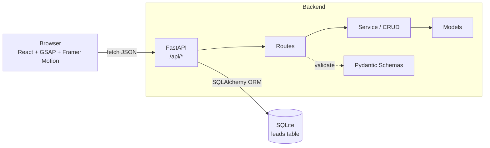
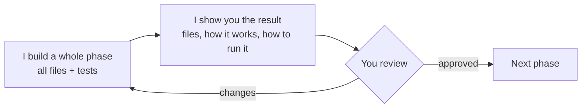

# KINETIQ (Mini CRM Dashboard) — Task Implementation Plan

> SHL Tech Internship · Task 1
> Stack: **FastAPI + Python 3.12** · **SQLite (SQLAlchemy 2.0)** · **React (Vite) + GSAP + Framer Motion** · **Vercel / Netlify**

---

## 1. Goal

Build a lead-tracking dashboard where a business can:

| Requirement (from brief) | How we deliver it |
|---|---|
| Dashboard overview: total / new / converted | `GET /api/leads/stats` → animated stat cards (GSAP count-up) |
| Add / edit / delete leads | REST endpoints + modal form + confirm dialog |
| Lead fields: name, email, phone, business, status | `Lead` table + Pydantic schema with validation |
| Search by name or email | `?search=` query param (case-insensitive `LIKE`), debounced input |
| Filter by status | `?status=` query param + filter chips |
| Update status | `PATCH /api/leads/{id}/status` + inline status dropdown |
| Persist data | SQLite via SQLAlchemy (hosted SQLite in production, see §8) |
| Responsive, loading, empty, error states, validation | Skeletons, empty-state, error banner + retry, toasts, client + server validation |

**Definition of "production ready" for this project:** env-based config, input validation on both sides, consistent JSON error format, CORS locked to the frontend origin, automated backend tests, a seed script, no secrets in the repo, and a README someone else can follow from zero.

---

## 2. Architecture



**Request lifecycle (e.g. "Add lead"):**
1. User fills the form → client-side validation (same rules as backend).
2. `POST /api/leads` with JSON body.
3. FastAPI validates with the Pydantic schema → 422 with field errors if invalid.
4. Service layer checks duplicate email → 409 if it exists.
5. Row inserted, `201 Created` with the new lead.
6. Frontend invalidates the leads + stats queries → list and stat cards refresh, toast shown.

---

## 3. Data Model

**Table `leads`**

| Column | Type | Rules |
|---|---|---|
| `id` | INTEGER PK | auto-increment |
| `name` | VARCHAR(100) | required, 2–100 chars, trimmed |
| `email` | VARCHAR(255) | required, valid email, **unique**, stored lowercase |
| `phone` | VARCHAR(20) | required, 7–15 digits, may contain `+ - ( )` and spaces |
| `business_name` | VARCHAR(150) | required, 2–150 chars |
| `status` | VARCHAR(20) | enum: `New`, `Contacted`, `Converted` (default `New`) |
| `notes` | TEXT | optional, ≤ 1000 chars (small extra, useful in a CRM) |
| `created_at` | DATETIME | set on insert (UTC) |
| `updated_at` | DATETIME | set on insert and every update (UTC) |

Indexes: `email` (unique), `status`, `created_at`.

---

## 4. API Contract

Base path: `/api`. Interactive docs at `/api/docs` (Swagger) — handy for reviewers.

| Method | Endpoint | Purpose | Success |
|---|---|---|---|
| GET | `/api/health` | Liveness + DB check | 200 |
| GET | `/api/leads` | List leads. Query: `search`, `status`, `page`, `page_size`, `sort` | 200 `{items, total, page, page_size}` |
| GET | `/api/leads/stats` | `{total, new, contacted, converted, conversion_rate}` | 200 |
| GET | `/api/leads/analytics` | Chart data for `days` (7–365) in the viewer's timezone: timeline, status split, heatmap | 200 |
| GET | `/api/leads/{id}` | Single lead | 200 |
| POST | `/api/leads` | Create lead | 201 |
| PUT | `/api/leads/{id}` | Edit lead (all editable fields) | 200 |
| PATCH | `/api/leads/{id}/status` | Change status only | 200 |
| DELETE | `/api/leads/{id}` | Delete lead | 204 |

**Uniform error shape** (every non-2xx response):
```json
{
  "error": {
    "code": "VALIDATION_ERROR",
    "message": "Some fields are invalid.",
    "details": [{ "field": "email", "message": "Enter a valid email address." }]
  }
}
```
Codes: `VALIDATION_ERROR` (422), `NOT_FOUND` (404), `DUPLICATE_EMAIL` (409), `INTERNAL_ERROR` (500).

---

## 5. File Structure (IDE view)

```
CRM/
├── IMPLEMENTATION_PLAN.md        ← this file
├── README.md                     ← final submission README
├── .gitignore
│
├── backend/
│   ├── app/
│   │   ├── __init__.py
│   │   ├── main.py               ← app factory, CORS, routers, error handlers
│   │   ├── core/
│   │   │   ├── __init__.py
│   │   │   ├── config.py         ← settings from env (pydantic-settings)
│   │   │   ├── database.py       ← engine, SessionLocal, Base, get_db()
│   │   │   └── exceptions.py     ← custom errors + JSON error handlers
│   │   ├── models/
│   │   │   ├── __init__.py
│   │   │   ├── types.py          ← UTCDateTime column type (timezone-safe timestamps)
│   │   │   └── lead.py           ← SQLAlchemy Lead model + LeadStatus enum
│   │   ├── schemas/
│   │   │   ├── __init__.py
│   │   │   └── lead.py           ← Pydantic: LeadCreate, LeadUpdate, LeadStatusUpdate, LeadOut, LeadList, LeadStats
│   │   ├── services/
│   │   │   ├── __init__.py
│   │   │   └── lead_service.py   ← all DB logic (list/search/filter/create/update/delete/stats)
│   │   └── api/
│   │       ├── __init__.py
│   │       ├── deps.py           ← shared dependencies (DbSession)
│   │       ├── router.py         ← mounts all route modules under /api
│   │       └── routes/
│   │           ├── __init__.py
│   │           ├── health.py
│   │           └── leads.py      ← thin HTTP layer calling lead_service
│   ├── tests/
│   │   ├── __init__.py
│   │   ├── conftest.py           ← in-memory SQLite + TestClient fixtures
│   │   ├── test_app.py           ← health, CORS, 404/405/500 error shape, docs
│   │   ├── test_leads_crud.py
│   │   ├── test_leads_search_filter.py
│   │   └── test_validation.py
│   ├── scripts/
│   │   └── seed.py               ← inserts ~15 realistic sample leads
│   ├── requirements.txt
│   ├── requirements-dev.txt      ← pytest, httpx
│   ├── pytest.ini
│   └── .env.example
│
├── frontend/
│   ├── index.html
│   ├── package.json
│   ├── vite.config.js
│   ├── .env.example              ← VITE_API_URL
│   ├── public/
│   │   └── favicon.svg
│   └── src/
│       ├── main.jsx              ← React root, QueryClient, MotionConfig, Toaster
│       ├── App.jsx               ← page composition + filter/dialog state
│       ├── styles/index.css      ← Tailwind v4 theme tokens (blue/purple/yellow/orange on white)
│       ├── lib/
│       │   ├── constants.js      ← statuses, status colours, sort options, page size
│       │   ├── validation.js     ← zod schema mirroring backend rules
│       │   ├── format.js         ← relative dates, initials
│       │   ├── chart.js          ← chart helpers: monotone curve, axis ticks, heat ramp, buckets
│       │   └── motion.js         ← GSAP setup, reduced-motion helper, Framer variants
│       ├── api/
│       │   ├── client.js         ← fetch wrapper: timeout, friendly ApiError
│       │   └── leads.js          ← one function per endpoint
│       ├── hooks/
│       │   ├── useLeads.js       ← TanStack Query hooks (queries, mutations, optimistic status)
│       │   ├── useDebounce.js
│       │   └── useElementWidth.js ← ResizeObserver for responsive SVG
│       └── components/
│           ├── layout/Header.jsx
│           ├── dashboard/
│           │   ├── StatsGrid.jsx       ← 4 cards, GSAP staggered entrance
│           │   ├── StatCard.jsx        ← clickable card (filters table)
│           │   └── AnimatedNumber.jsx  ← GSAP count-up
│           ├── analytics/
│           │   ├── AnalyticsSection.jsx ← 7/30/90-day range picker + chart grid
│           │   ├── ChartCard.jsx       ← chart frame + Chart/Table toggle + DataTable
│           │   ├── ChartTooltip.jsx
│           │   ├── TrendChart.jsx      ← SVG area/line graph with crosshair
│           │   ├── StatusDonut.jsx     ← SVG donut (pie) with legend
│           │   └── ActivityHeatmap.jsx ← weekday × time-of-day heatmap
│           ├── leads/
│           │   ├── LeadsPanel.jsx      ← loading / error / empty / results states
│           │   ├── LeadsToolbar.jsx    ← search + status filter + sort
│           │   ├── StatusFilter.jsx    ← segmented filter (Framer layoutId pill)
│           │   ├── LeadsTable.jsx      ← desktop table (md+)
│           │   ├── LeadCardList.jsx    ← mobile cards
│           │   ├── LeadAvatar.jsx, LeadActions.jsx, StatusSelect.jsx, Pagination.jsx
│           │   ├── LeadFormModal.jsx   ← add / edit (react-hook-form + zod)
│           │   └── DeleteLeadDialog.jsx
│           └── ui/
│               ├── Button.jsx, Field.jsx, Skeleton.jsx
│               ├── Modal.jsx           ← Radix Dialog + Framer Motion
│               ├── EmptyState.jsx
│               └── ErrorState.jsx      ← message + Try again
│
└── (deployment files, added in Phase 3 — depend on option chosen in §8)
    ├── vercel.json / netlify.toml
    └── backend/api/index.py or Procfile
```

> Design direction came from the `ui-ux-pro-max:design` skill (flat SaaS style, Plus Jakarta Sans, Lucide icons) with the requested white background and blue/purple/yellow/orange palette. Charts follow the `dataviz` skill (palette validated for colour-blind separation; every chart has a table view).

---

## 5b. Added in Phase 2 (on request)

| Feature | Backend | Frontend |
|---|---|---|
| Login / sign-up, per-account leads | `models/user.py`, `core/security.py` (Argon2 + JWT cookie), `core/rate_limit.py`, `api/routes/auth.py`, `services/auth_service.py`, `owner_id` on every lead query | `pages/AuthPage.jsx`, `components/auth/*`, `hooks/useAuth.js`, `components/layout/UserMenu.jsx`, `App.jsx` (login gate) |
| Sample data for any account | `services/sample_data.py`, `POST /api/leads/sample-data` | "Load sample leads" in the empty state |
| Lead profile card | `GET /api/leads/{id}` | `components/leads/LeadProfileDrawer.jsx` |
| Clive, AI assistant | `services/clive.py` (Groq `openai/gpt-oss-120b`, own tool-calling loop, 4 read-only tools), `scripts/clive_live_check.py`, `api/routes/clive.py`, `schemas/clive.py` | `components/clive/*` (provider, widget, messages) |
| Tests | `tests/test_auth.py`, `tests/test_clive.py` (model faked, no API cost) | |

---

## 6. Project Workflow (how we work together)



- Each **phase** is built in one go (the step tables in §7 are the internal checklist, not review gates).
- At the end of a phase I show: what was built, how each part works, test results, and commands to try it yourself.
- I don't start the next phase until you approve.
- Git: `git init` in Phase 0; one commit per approved phase (only when you say so).

---

## 7. Phases & Steps

### Phase 0 — Project setup
| # | Files | Output / check |
|---|---|---|
| 0.1 | `.gitignore`, folder skeleton, `README.md` stub, `git init` | Clean repo structure |
| 0.2 | `backend/.venv` + `requirements.txt`, `requirements-dev.txt` | `pip install` succeeds |

### Phase 1 — Backend (FastAPI + SQLite)
| # | Files | What it does | Verify |
|---|---|---|---|
| 1.1 | `core/config.py`, `.env.example` | Typed settings: `DATABASE_URL`, `CORS_ORIGINS`, `ENV` | import + print settings |
| 1.2 | `core/database.py` | Engine (SQLite `check_same_thread=False`, WAL), session factory, `get_db` dependency | — |
| 1.3 | `models/lead.py` | `Lead` table, `LeadStatus` enum, timestamps, indexes | tables created on startup |
| 1.4 | `schemas/lead.py` | Request/response models, trimming, email/phone validation | quick REPL checks |
| 1.5 | `services/lead_service.py` | Search (name/email, case-insensitive), filter, pagination, sort, CRUD, stats, duplicate-email guard | — |
| 1.6 | `core/exceptions.py` | `NotFoundError`, `DuplicateEmailError`, handlers producing the uniform error shape | — |
| 1.7 | `api/routes/health.py`, `api/routes/leads.py` | Thin route layer, status codes, query params | — |
| 1.8 | `main.py` | App factory, CORS, router mount, handlers, create tables on startup | `uvicorn app.main:app --reload` → `/api/docs` works |
| 1.9 | `scripts/seed.py` | Sample data (idempotent) | `python -m scripts.seed` → leads visible in `/docs` |
| 1.10 | `tests/*`, `pytest.ini` | CRUD, search/filter, validation, 404/409 cases | `pytest` all green |

**✅ Phase 1 exit:** all endpoints work in Swagger, tests pass, data survives a server restart.

### Phase 2 — Frontend (React + GSAP + Framer Motion)
| # | Files | What it does |
|---|---|---|
| 2.0 | — | **I ask you for the frontend Claude skills**, then propose the visual direction (colors, type, layout) for your OK |
| 2.1 | Vite scaffold, `package.json`, `vite.config.js`, `.env.example`, `styles/index.css` | Project boots, design tokens in place |
| 2.2 | `api/client.js`, `api/leads.js` | Fetch wrapper → normalised errors from the uniform error shape |
| 2.3 | `hooks/useLeads.js`, `hooks/useDebounce.js` | Queries/mutations, cache invalidation of list + stats |
| 2.4 | `components/ui/*` | Button, Input, Modal, Skeleton, EmptyState, ErrorState |
| 2.5 | `layout/*`, `dashboard/*` | Header + stats grid with GSAP count-up and entrance timeline |
| 2.6 | `leads/LeadsToolbar.jsx`, `LeadsTable.jsx`, `LeadCard.jsx`, `StatusBadge.jsx` | List with search (debounced) + status filter; table on desktop, cards on mobile; Framer Motion layout animations on add/remove |
| 2.7 | `lib/validation.js`, `leads/LeadFormModal.jsx` | Add/edit form, inline field errors, server errors mapped to fields (e.g. duplicate email) |
| 2.8 | `leads/StatusSelect.jsx`, `leads/DeleteLeadDialog.jsx` | Inline status change (optimistic), delete with confirmation |
| 2.9 | `App.jsx`, `main.jsx` | Wire everything; loading / empty / "no results for filter" / error + retry; toasts |
| 2.10 | polish pass | Responsive check (375px → 1440px), keyboard + focus states, `prefers-reduced-motion` respected |

**✅ Phase 2 exit:** every feature in the brief works against the local backend on mobile and desktop.

### Phase 3 — Deployment & submission
| # | Task |
|---|---|
| 3.1 | Create GitHub repo and push (you confirm the repo name/visibility first) |
| 3.2 | Provision production database (per §8 choice) |
| 3.3 | Deploy backend, set env vars (`DATABASE_URL`, `CORS_ORIGINS`) |
| 3.4 | Deploy frontend, set `VITE_API_URL` |
| 3.5 | Live smoke test of every feature + seed demo data |
| 3.6 | Final `README.md`: what it is, live link, local setup, **database setup instructions**, tech choices & why, challenges faced, API reference, screenshots |

**✅ Phase 3 exit:** live link + GitHub repo + README ready to submit.

---

## 8. ⚠️ Deployment decision: SQLite on Vercel/Netlify

Vercel and Netlify run backends as **serverless functions with a temporary, read-only filesystem**. A plain `crm.db` file there would be **wiped on every cold start/redeploy** — which would fail the "data doesn't disappear" requirement. Options:

| Option | Frontend | Backend | Database | Pros | Cons |
|---|---|---|---|---|---|
| **A (recommended)** | Vercel | Vercel (FastAPI as Python function, same domain) | **Turso** — hosted SQLite (libSQL), free tier | One live link, no CORS hassle, still SQLite, free, persistent | Extra driver (`sqlalchemy-libsql`); cold starts on first request |
| B | Vercel or Netlify | Render / Railway (always-on container) | SQLite file on a **persistent disk/volume** | Real SQLite file, simplest code | Persistent disk is paid on Render; Railway needs trial credit; two URLs + CORS |
| C | Vercel | Vercel | SQLite file in `/tmp` | Zero setup | ❌ Data lost — not acceptable |

The backend code is identical for A and B: only `DATABASE_URL` changes. Local development always uses a plain SQLite file (`sqlite:///./crm.db`). **This decision is only needed before Phase 3.**

---

## 9. Tech choices (draft for README "why")

- **FastAPI** — automatic request validation via Pydantic, auto-generated Swagger docs (reviewers can test the API in the browser), async-ready, very readable.
- **SQLAlchemy 2.0** — ORM keeps SQL safe from injection and lets us swap SQLite → hosted SQLite/Postgres by changing one env var.
- **SQLite** — zero-config, single file, perfect for a small CRM; Turso keeps it SQLite in production.
- **React + Vite** — fast dev server, simple build, component model fits table/form/modal UI.
- **TanStack Query** — handles loading/error/cache states and refetching after mutations, which covers several UX requirements cleanly.
- **react-hook-form + zod** — client validation that mirrors the backend rules.
- **GSAP** — timeline-based entrance and number count-up on the dashboard.
- **Framer Motion** — declarative animations for modals, list add/remove, and layout changes.
- **pytest** — proves the backend works and guards against regressions.

---

## 10. Risks & how we handle them

| Risk | Mitigation |
|---|---|
| SQLite concurrency (`database is locked`) | WAL mode, short sessions, one session per request |
| Duplicate emails | DB unique constraint **and** service-level check → friendly 409 |
| Frontend/backend validation drift | Same rules documented in §3, mirrored in `validation.js` |
| CORS errors in production | `CORS_ORIGINS` env var; same-origin if Option A |
| Too much animation hurting UX | Short durations, `prefers-reduced-motion` support, no animation blocking input |
| Cold-start delay on serverless | Skeleton loaders so the UI never looks broken |
